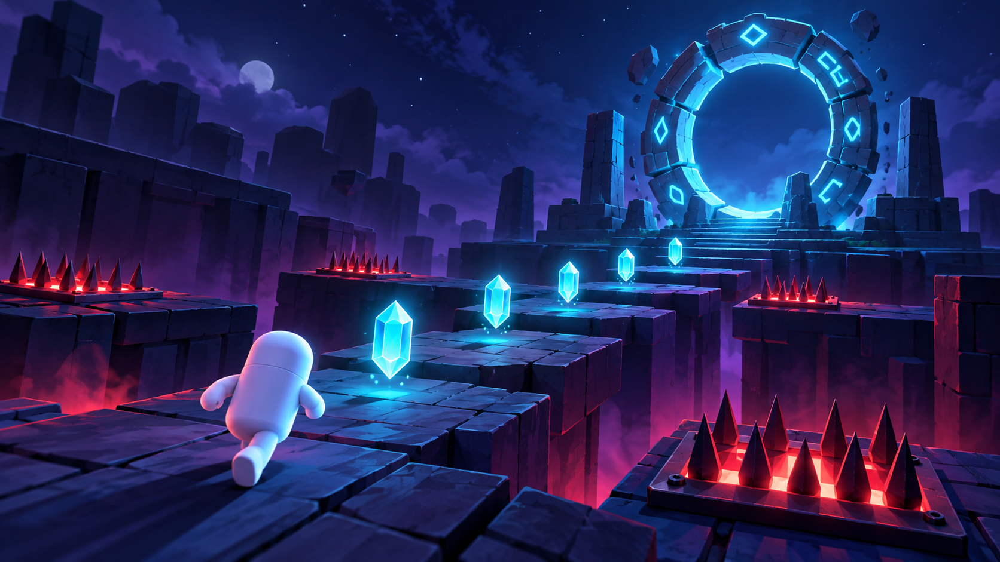

# Crystal Escape

**AME 294 — Portfolio Game 3: Unreal or Unity, Built with AI**

Public source repository: <https://github.com/sujinbae11/CRYSTAL-ESCAPE>

Crystal Escape is a compact third-person 3D collection game. The player has three health points and must collect five crystals, survive hazardous spike fields, and enter the exit portal. Both victory and defeat end in clear terminal screens with an immediate restart option.

## Current development status

The complete playable Unity gameplay scaffold is included and generates its level automatically when Play begins. It includes:

- responsive WASD movement, mouse look, and jumping;
- five functional reward collectibles;
- three functional damage hazards with one-second damage cooldown;
- health and crystal HUD;
- locked portal until every crystal is collected;
- win, loss, restart, and quit flows;
- start screen and stranger-readable controls;
- runtime placeholder sound and support for imported generated audio;
- runtime loading and functional sockets for three mandatory Tripo assets.

All three bespoke Tripo assets are generated, optimized to roughly 10K quads, exported as FBX with 2K textures, and wired to the functional Reward, Damage, and End sockets. Before the final course submission, replace the placeholder audio with Week 6 generated audio, test a packaged build, record gameplay, and finish the trailer. These pending requirements are intentionally documented rather than falsely represented as complete.

## Open and play

Recommended editor: Unity `6000.0` or a compatible later Unity 6 release.

1. Open this repository folder as a Unity project.
2. Wait for package and script import to finish.
3. Choose **Crystal Escape > Prepare Project** if the scene does not open automatically.
4. Press Play.
5. Select **Start Run**.

The repository includes `Assets/CrystalEscape/Scenes/MainGame.unity` in the build list. The runtime bootstrap creates the complete game in that scene when Play begins.

## Controls

| Input | Action |
|---|---|
| WASD | Move |
| Mouse | Look |
| Space | Jump |
| Escape | Release the mouse cursor |
| Left click | Capture the cursor again |

## Required gameplay loop

- **Reward:** collect five glowing crystals; each gives positive visual and audio feedback.
- **Damage:** spike zones remove one health point, with a one-second invulnerability window.
- **End — win:** collect all five crystals and enter the portal.
- **End — loss:** health reaches zero.
- **Restart:** available from either terminal state without restarting the editor.

## Build

From the Unity menu, select:

- **Crystal Escape > Build Windows**, or
- **Crystal Escape > Build WebGL**.

Build outputs go to the ignored `Builds/` directory. Upload the resulting ZIP to a GitHub Release or itch.io; do not commit packaged builds into the repository.

If Unity cannot be installed locally, connect this Git repository to [Unity Build Automation](https://docs.unity.com/en-us/build-automation) and choose Windows or WebGL as the target. The service can detect the editor version from `ProjectSettings/ProjectVersion.txt`.

## Tripo assets

The three mandatory functional assets are:

1. Crystal reward collectible
2. Spike damage hazard
3. Exit portal

Store the functional runtime files under `Assets/CrystalEscape/Resources/Tripo/` with these exact paths:

- `Crystal/Crystal.fbx`
- `SpikeTrap/SpikeTrap.fbx`
- `ExitPortal/ExitPortal.fbx`

The game loads these assets automatically and falls back to primitive placeholders only when a file is absent. Keep generation prompts, route, original format, optimization steps, and final placement in `Documentation/PROMPT_LOG.md`.

## Audio

Put generated audio in `Assets/CrystalEscape/Resources/Audio/` using the exact names described in that folder's README. The game will automatically replace its synthesized development tones with those clips.

## Documentation

- [Prompt log](Documentation/PROMPT_LOG.md)
- [Asset attribution](Documentation/ASSET_ATTRIBUTION.md)
- [Reflection worksheet](Documentation/REFLECTION.md)
- [Testing checklist](Documentation/TESTING.md)
- [Trailer plan](Trailer/TRAILER_PLAN.md)

## Generative AI inventory

Update this list with every tool actually used before submission.

| Area | Tool | Use |
|---|---|---|
| Planning and code | OpenAI Codex | Project scaffold, Unity C# systems, documentation structure |
| 3D | Tripo Studio H3.1 / Smart Mesh | Crystal, spike trap, and portal; FBX export and topology optimization |
| Audio | Pending | BGM and gameplay sound effects |
| Image | OpenAI built-in image generation | 16:9 key art and trailer opening frame |
| Video | Pending | Image-to-video trailer shots and final edit |

## Repository hygiene

The Unity `.gitignore` excludes `Library/`, `Temp/`, `Logs/`, `Build/`, `Builds/`, and IDE-generated files. Packaged games belong in Releases or itch.io.

